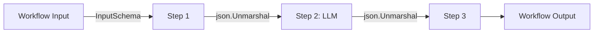

Typed schemas enforce structured input and output at workflow and step boundaries, catching malformed LLM responses before they propagate downstream.

## The Problem

LLM outputs are inherently unstructured. Even with structured output modes, models can produce unexpected formats, missing fields, or wrong types. Without validation, a malformed response from step 3 silently corrupts the input to step 7, and you debug for hours.

DagNats validates at two levels: a **workflow input schema** checks the input of a run before it starts, and **handler-level typing** validates data at each step boundary within Go code. A workflow can also carry an output schema, but the engine does not check outputs against it.

## Workflow Input/Output Schemas

`WorkflowDef` has `InputSchema` and `OutputSchema` fields (`input_schema` and `output_schema` in JSON). The engine checks a run's input against `InputSchema` before the run starts. `OutputSchema` is not enforced: it describes the result, and the generated OpenAPI spec for HTTP-triggered workflows publishes it as the response body.

The builder has no schema methods. Set the fields on the built definition:

```go
wf := dag.NewWorkflow("code-review")
wf.Task("review", "llm-review").WithTimeout(60 * time.Second)

def, err := wf.Build()
if err != nil {
    log.Fatal(err)
}

def.InputSchema = json.RawMessage(`{
  "type": "object",
  "required": ["repo", "branch"],
  "properties": {
    "repo":   {"type": "string"},
    "branch": {"type": "string"},
    "files":  {"type": "array", "items": {"type": "string"}}
  }
}`)
def.OutputSchema = json.RawMessage(`{
  "type": "object",
  "required": ["summary", "issues"],
  "properties": {
    "summary": {"type": "string"},
    "issues":  {"type": "array"}
  }
}`)
```

To generate both schemas from Go types instead, call `dag.WithSchemas[In, Out](def)` on the built definition. It supports flat structs, primitives, slices and maps, and takes field names from the `json` tags.

The validator understands a subset of JSON Schema: `type` (`string`, `number`, `boolean`, `object`, `array`), `required`, and nested `properties`. Other keywords, including `items`, `enum`, `minimum` and `pattern`, are ignored.

`dagnats run start` and `POST /runs` reject input that fails the schema, so no run is created. If the input reaches the engine some other way, the engine records a failed run with an `input validation` error. Either way the problem shows up at the boundary, not deep in the pipeline.

## Typed Handlers for Structured LLM I/O

Within handlers, use Go structs to enforce types on step input and output. `worker.HandleTyped` does the decoding and encoding for you; the version below does it by hand so each failure mode can be chosen:

```go
type ReviewInput struct {
    Repo   string   `json:"repo"`
    Branch string   `json:"branch"`
    Files  []string `json:"files"`
}

type ReviewOutput struct {
    Summary string  `json:"summary"`
    Issues  []Issue `json:"issues"`
    Score   float64 `json:"score"`
}

w.Handle("llm-review", func(ctx worker.TaskContext) error {
    var input ReviewInput
    if err := json.Unmarshal(ctx.Input(), &input); err != nil {
        return ctx.FailPermanent(
            fmt.Errorf("invalid input schema: %w", err),
        )
    }

    response, err := callLLMStructured(input)
    if err != nil {
        return ctx.Fail(err)
    }

    // Validate the LLM's response parses correctly
    var output ReviewOutput
    if err := json.Unmarshal(response, &output); err != nil {
        return ctx.Fail(
            fmt.Errorf("LLM response schema mismatch: %w", err),
        )
    }

    data, _ := json.Marshal(output)
    return ctx.Complete(data)
})
```

Two different failure modes: invalid **input** is `FailPermanent` (the upstream step produced bad data; retrying will not help). Invalid **LLM response** is `Fail` (the model might produce valid output on retry).

## Schema Generation from Go Types

For handlers that need to communicate their schema to the LLM (e.g., for structured output mode), derive the schema from the Go struct:

```go
type ToolCallSchema struct {
    Name      string         `json:"name"`
    Arguments map[string]any `json:"arguments"`
}

func schemaFromType(v any) map[string]any {
    // Reflect on struct fields to produce JSON Schema
    // This is a simplified example; real implementations
    // handle nested types, slices, and optionality.
    t := reflect.TypeOf(v)
    props := make(map[string]any)
    required := []string{}
    for i := 0; i < t.NumField(); i++ {
        field := t.Field(i)
        tag := field.Tag.Get("json")
        props[tag] = map[string]any{"type": goTypeToJSON(field.Type)}
        required = append(required, tag)
    }
    return map[string]any{
        "type":       "object",
        "properties": props,
        "required":   required,
    }
}
```

Pass the generated schema to the LLM's structured output parameter so the model knows exactly what format to produce. When the response comes back, `json.Unmarshal` into the same Go type validates it.

## Validation at Step Boundaries

Each step boundary is a validation point:



Data flows through the DAG as `[]byte`. Only the workflow input has an engine-side check. Each handler deserializes its input, validates the structure, does its work, and serializes its output. The next handler deserializes and validates again. Malformed data fails at the first handler that touches it, with a clear error message identifying the schema mismatch.

## Related

- [Tool Use as Steps](/docs/ai-patterns/tool-use-as-steps) -- typed tool handlers
- [Planner Pattern](/docs/ai-patterns/planner-pattern) -- validating LLM-generated plans
- [Error Handling](/docs/reliability/error-handling) -- FailPermanent vs Fail for schema errors
