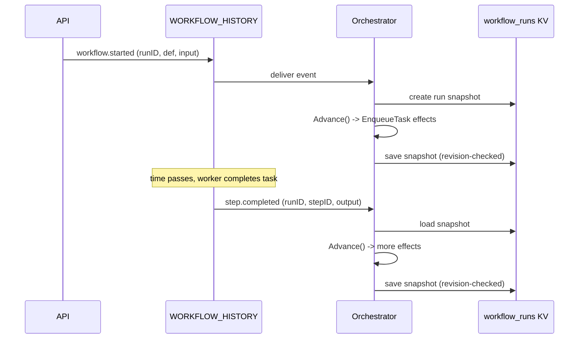
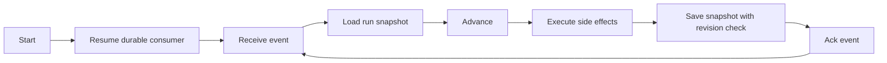

DagNats is event-driven. Every state change is an immutable event on the `WORKFLOW_HISTORY` stream, and the engine advances a run by handling those events one at a time. The stream is the ordered record of what happened; the `workflow_runs` KV bucket holds the current state of each run.

## Why Events

Traditional workflow engines store mutable rows: update the step status, overwrite the output, increment the retry counter. This makes debugging hard (what happened between states?) and auditing impossible (who changed what when?).

DagNats records **what happened** as an append-only log and keeps a snapshot of where each run stands now. A workflow run *is* a sequence of events: started, step completed, step failed, workflow completed. Storing those events directly means the log is both the thing that drives the engine and the audit trail for a run.

## The Event Log

Every state change publishes an immutable event to the `WORKFLOW_HISTORY` JetStream stream at subject `history.{runID}`.

### Event Types

The system defines these event types, each carrying a typed payload:

| Event | Published When |
|-------|---------------|
| `workflow.started` | API starts a new run |
| `workflow.completed` | All steps completed |
| `workflow.failed` | Step failure exhausted retries |
| `workflow.cancelled` | Run cancelled via API |
| `workflow.spawn` | Sub-workflow launched |
| `workflow.child.completed` | Child workflow finished |
| `workflow.child.failed` | Child workflow failed |
| `step.queued` | Engine dispatches a step's task |
| `step.started` | A worker begins an attempt |
| `step.completed` | Worker reports success |
| `step.failed` | Worker reports failure |
| `step.cancelled` | Step cancelled |
| `step.continue` | Agent loop iteration |
| `step.sleep.started` | Sleep step begins |
| `step.sleep.completed` | Sleep duration elapsed |
| `step.wait.started` | Wait-for-event step begins |
| `step.wait.matched` | External event matched |
| `step.wait.timeout` | Wait timed out |
| `step.map.started` | Map fan-out begins |
| `step.map.completed` | All map instances done |
| `step.map.instance.completed` | One map instance done |
| `agent.loop.iteration` | Agent loop progress |
| `approval.requested` | Approval gate opened |
| `approval.granted` | Approval accepted |
| `approval.rejected` | Approval rejected |
| `approval.expired` | Approval timed out |
| `planner.materialized` | Planner steps added to the run |
| `compensate.started` | Compensation chain begins |
| `compensate.step.completed` | Compensation step done |
| `compensate.failed` | Compensation failed |
| `compensate.completed` | All compensation done |

## Deduplication

Every event published to `WORKFLOW_HISTORY` includes a `Nats-Msg-Id` header. The stream's 5-second dedup window rejects a duplicate publish. This means the engine and workers can safely retry event publishing without risk of double-processing.

The dedup ID is built from the run, event type and, where relevant, the step and attempt, so each event is naturally idempotent.

## KV Snapshots

The `workflow_runs` KV bucket stores a **snapshot** of each run: status, step states, outputs, error messages and timing data. It is the engine's working state.

For every event the engine loads the run's snapshot, runs `Advance()`, executes the resulting side effects, and saves the snapshot back. The save is a compare-and-swap on the KV revision: if another engine (a cluster has one per node) changed the run since it was loaded, the write is rejected and the engine reloads and redoes the transition. Snapshots also serve `GET /runs/{id}` directly, without touching the stream.

Because the engine reads the snapshot for every event, the snapshot is authoritative for a run's current state. The event log is not replayed to rebuild it. Terminal runs are pruned from the bucket after `runs_max_age` (default 30 days).

## Consumption and Recovery

The engine reads `history.>` through a durable pull consumer named `orchestrator` with explicit acknowledgements.

- **Restarts resume, not replay.** The consumer's acknowledged position persists, so a restarted engine continues from the first unacknowledged event. Only the first start of a fresh deployment reads the stream from the beginning.
- **Unacknowledged events are redelivered** on a backoff from 5 seconds up to 3 minutes. After eight deliveries an event is dead-lettered rather than retried forever.
- **Handlers are idempotent.** An event for a run that already reached a terminal state, or for a step that has moved past it, is ignored. Redelivery and duplicate events change nothing.
- **A reconciler repairs stalls.** Every 60 seconds it looks for runs stuck in `running` with no step in flight. It completes a run whose steps are all done, and fails one that has no path forward, recording why in a synthetic step state.

## Stateless Engine

The engine holds no per-run state in memory between events. All state lives in the history stream and the `workflow_runs` snapshots. This means:

- **Restarts are safe**: kill the process, start it again, and it resumes from the consumer position.
- **No external database**: there is no schema to migrate.
- **Clusters work**: every node runs an engine against the same stream and bucket, and the snapshot revision check serializes writes to a run.

## Trade-offs

- **Storage grows with traffic**: `WORKFLOW_HISTORY` keeps 30 days of events and is also capped by a share of the store budget. Size `max_store_bytes` for your run rate.
- **The snapshot matters**: losing the `workflow_runs` bucket loses current run state even though recent events remain. Replicate it (cluster mode) or back up the data directory.
- **Event schema evolution**: changing event payloads requires backward compatibility. DagNats keeps payloads as `json.RawMessage` and parses defensively.
