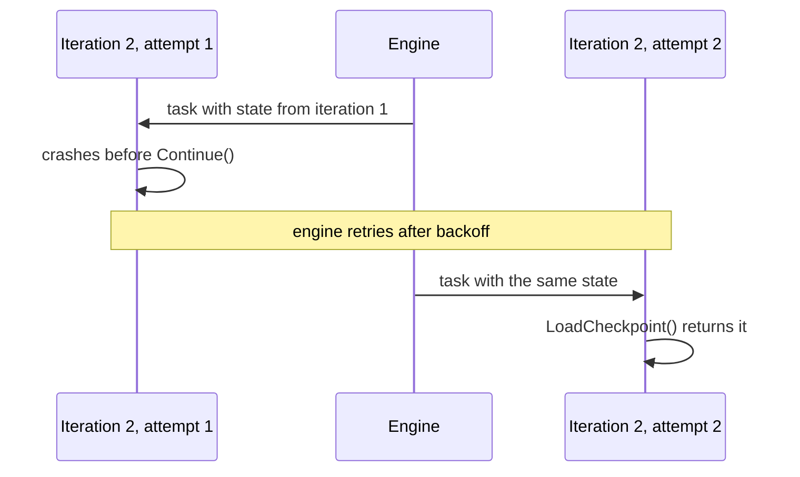

Checkpoints carry handler state from one agent loop iteration to the next, and to a retry of that iteration.

## Overview

When a step handler crashes, times out, or calls `Continue()` in an agent loop, the engine re-enqueues the task. Without checkpoints, the handler restarts from scratch every time. `Checkpoint()` and `LoadCheckpoint()` give an agent loop a place to keep its state between iterations.

`Checkpoint()` writes nothing by itself. It buffers the state, and `Continue()` sends it inside the `step.continue` event. The engine saves the state with the run in the same write that advances the iteration, and hands it back in the next task. So saving and continuing are one step: a crash before `Continue()` leaves nothing saved, and the redelivered iteration starts from the state the crashed one started from. State is capped per step by the engine setting `loop_state_max_bytes` (256 KiB by default). For a step that calls `Journal()`, the state is part of the iteration's `commit` record in the [agent journal](/docs/ai-patterns/durable-agents) and the cap does not apply.

Checkpoints are especially important for LLM agent loops where conversation history accumulates over many iterations. Losing that history means replaying expensive API calls. With `Checkpoint()` and `LoadCheckpoint()`, the handler saves its conversation state after each LLM call and restores it on the next iteration or retry.

## API

### Checkpoint

Buffers state for the next `Continue()`. Overwrites any value buffered earlier in the same iteration. `Checkpoint(nil)` clears the state. State is only saved by a `Continue()`: a step that calls `Complete()` or `Fail()` after `Checkpoint()` saves nothing.

```go
w.Handle("summarize", func(ctx worker.TaskContext) error {
    partial, _ := ctx.LoadCheckpoint()
    result, err := processChunk(ctx.Input(), partial)
    if err != nil {
        return ctx.Fail(err)
    }
    if err := ctx.Checkpoint(result.State); err != nil {
        return ctx.Fail(err)
    }
    return ctx.Complete(result.Output)
})
```

### LoadCheckpoint

Returns the state this iteration should start from: what `Checkpoint()` buffered earlier in this same call, else the state the engine committed with the step's last accepted `Continue()`. Returns `(nil, nil)` if there is none.

```go
w.Handle("agent-step", func(ctx worker.TaskContext) error {
    state, err := ctx.LoadCheckpoint()
    if err != nil {
        return ctx.Fail(err)
    }
    if state == nil {
        state = ctx.Input() // first execution
    }
    // ... continue from saved state
    return ctx.Complete(state)
})
```

### Pause and Resume

`Pause()` combines a checkpoint with a NAK-with-delay, creating a clean pause/resume pattern without involving the engine. The step stays in `Running` status while the NATS message is redelivered after the delay.

```go
w.Handle("rate-limited", func(ctx worker.TaskContext) error {
    state, _ := ctx.LoadCheckpoint()
    if isPauseResume(state) {
        state = extractResumeState(state)
    }
    result, err := callAPI(state)
    if err != nil && isRateLimited(err) {
        return ctx.Pause("rate-limit", 30*time.Second)
    }
    return ctx.Complete(result)
})
```

Under the hood, `Pause()` writes a JSON checkpoint with a `{"pause_resume": "name"}` marker, then calls `msg.NakWithDelay(duration)`. On the next delivery, `LoadCheckpoint()` returns the marker so the handler knows it is resuming from a pause. On a step that calls `Journal()`, `Pause()` appends a `pause` record to the journal instead, and `LoadCheckpoint()` returns the same marker.

The marker **replaces** any checkpoint the step saved earlier, because both live at the same key. If the handler needs its own state after a pause, it has to rebuild it, or keep it somewhere else. The step stays `Running` the whole time, and the paused time counts toward the step's timeout, so a step that pauses repeatedly needs a `Timeout` that covers its whole run.

## Persistence Across Retries

When an iteration fails and the engine retries it (via [retry policy](/docs/reliability/retry-policies)), the retry is a new attempt of the same iteration. It loads the state the last accepted `Continue()` committed, which is the state the failed attempt started from. State the failed attempt checkpointed but never continued with is gone. The retry skips work that earlier iterations finished:



To keep partial work inside one iteration, use the [agent journal](/docs/ai-patterns/durable-agents): it records each model response and tool result as it happens, and a retry or redelivery reuses them.

## Storage Details

| Property | Value |
|----------|-------|
| Where state lives | The run snapshot, as part of the step's state, or the journal's `commit` record for a journal step |
| Cap | `loop_state_max_bytes`, 256 KiB by default; none for a journal step |
| `checkpoints` KV bucket | Holds only the `Pause()` marker, key `{runID}.{stepID}`, kept 30 days |

`natsutil.SetupAll` provisions the `checkpoints` bucket, so `dagnats serve`, `dagnats-engine` and `dagnats-api` all create it at startup. Against an engine older than the state-in-the-event behaviour, the worker also writes `Checkpoint()` state to this bucket, so a rollout that upgrades workers first loses no state. In a cluster the bucket uses the cluster's replication factor; see [Clustering]().

## LLM Pattern: Checkpointing Conversation History

An agent loop handler saves the full conversation after each LLM call:

```go
w.Handle("llm-agent", func(ctx worker.TaskContext) error {
    var messages []Message
    saved, _ := ctx.LoadCheckpoint()
    if saved != nil {
        json.Unmarshal(saved, &messages)
    } else {
        messages = []Message{{Role: "user", Content: string(ctx.Input())}}
    }
    response, err := callLLM(messages)
    if err != nil {
        return ctx.Fail(err)
    }
    messages = append(messages, response.Message)
    data, _ := json.Marshal(messages)
    ctx.Checkpoint(data)
    if response.Done {
        return ctx.Complete([]byte(response.FinalAnswer))
    }
    return ctx.Continue(nil)
})
```

Each iteration adds to the conversation. If the worker crashes mid-iteration, the retry loads the state the last `Continue()` committed and repeats only the current iteration, not the entire conversation. With `Journal()`, it repeats only the calls that had not finished.

## Related

- [Signals](/docs/coordination/signals) -- cross-step communication via KV watches
- [Streaming](/docs/coordination/streaming) -- real-time output during execution
- [Agent Loops](/docs/step-types/agent-loops) -- iterative steps that rely on checkpoints
- [Retry Policies](/docs/reliability/retry-policies) -- when checkpoints matter most
