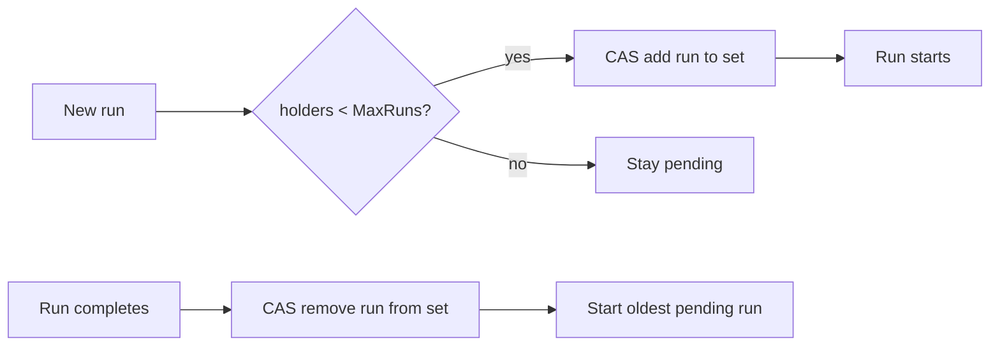

Concurrency limits control how many workflow runs and steps execute in parallel, preventing resource exhaustion and upstream overload.

## ConcurrencyLimit Configuration

The `ConcurrencyLimit` struct on `WorkflowDef` provides two scopes:

| Field | JSON Key | Type | Description |
|-------|----------|------|-------------|
| **MaxRuns** | `max_runs` | `int` | Max parallel runs of this workflow (0 = unlimited) |
| **MaxSteps** | `max_steps` | `int` | Max parallel steps within a single run (0 = unlimited; 0 to 1000) |

```go
wf := dag.NewWorkflow("code-review").
    WithConcurrency(3, 2)

def, _ := wf.Build()
// def.Concurrency.MaxRuns == 3
// def.Concurrency.MaxSteps == 2
```

## Per-Workflow Run Limits (MaxRuns)

`MaxRuns` caps how many runs of the same workflow execute simultaneously. When a new run starts and the limit is reached, the run remains in `pending` status until an active run completes.

### Implementation

Slots are tracked in the `concurrency_runs` KV bucket, one key per workflow (`workflow.<name>`), holding the set of run IDs that hold a slot. Updates use **compare-and-swap (CAS)**. A run adds itself to the set when it starts and is removed when it reaches a terminal state. Adding a run that is already in the set, or removing one that is not, does nothing, so a replayed event cannot free a slot that belongs to another run.



CAS retries are bounded at **10 attempts** to prevent infinite loops under contention. If all attempts fail, the acquire returns an error and the engine handles the `workflow.started` event again on redelivery.

### Pending Run Priority

When a slot opens, the engine starts the pending run of that workflow with the earliest **effective time**: its creation time, moved earlier by its priority offset. With no `PriorityConfig` that is plain FIFO by creation time. See [Priority](/docs/flow-control/priority).

## Per-Run Step Limits (MaxSteps)

`MaxSteps` limits how many steps within a single run execute concurrently. When the DAG has more ready steps than the limit allows, the engine queues the excess steps and dispatches them as running steps complete.

This is enforced in the `enqueueReady` path -- the engine counts in-flight steps and only dispatches up to the remaining budget. The excess steps are not lost: the next step completion runs the same path again.

## Per-Task-Type Limits

Beyond workflow-level limits, individual steps can cap global concurrency for their task type:

```go
callLLM := wf.Task("call-llm", "llm.chat").
    WithTimeout(60 * time.Second).
    WithTaskConcurrency(5)
```

This means at most 5 `llm.chat` tasks run across **all workflows** simultaneously. The slot holders live in the `concurrency_tasks` KV bucket: each key holds the set of steps (`<run_id>/<step_id>`) that hold a slot of that task type. Taking a slot a step already holds, or freeing one it does not, does nothing, so a retried or redelivered step cannot drift the count. If the limit is reached, the task is retried via `SLEEP_TIMERS` with a 1-second delay.

Counters written by a version before 0.0.27 read as no holders, so a limit can over-admit once for tasks in flight across the upgrade.

**Bounds:** 0 to 1000 for `max_task_concurrency` (0 = unlimited) and for `max_steps`.

## JSON Schema Example

```json
{
  "name": "deploy-pipeline",
  "version": "1",
  "concurrency": {
    "max_runs": 1,
    "max_steps": 3
  },
  "steps": [
    {
      "id": "build",
      "task": "build",
      "timeout": "10m",
      "type": "normal",
      "max_task_concurrency": 2
    }
  ]
}
```

## Related Pages

- [Rate Limiting](/docs/flow-control/rate-limiting) -- request-rate throttling
- [Priority](/docs/flow-control/priority) -- ordering pending runs
- [Retry Policies](/docs/reliability/retry-policies) -- retry behavior when concurrency-delayed
