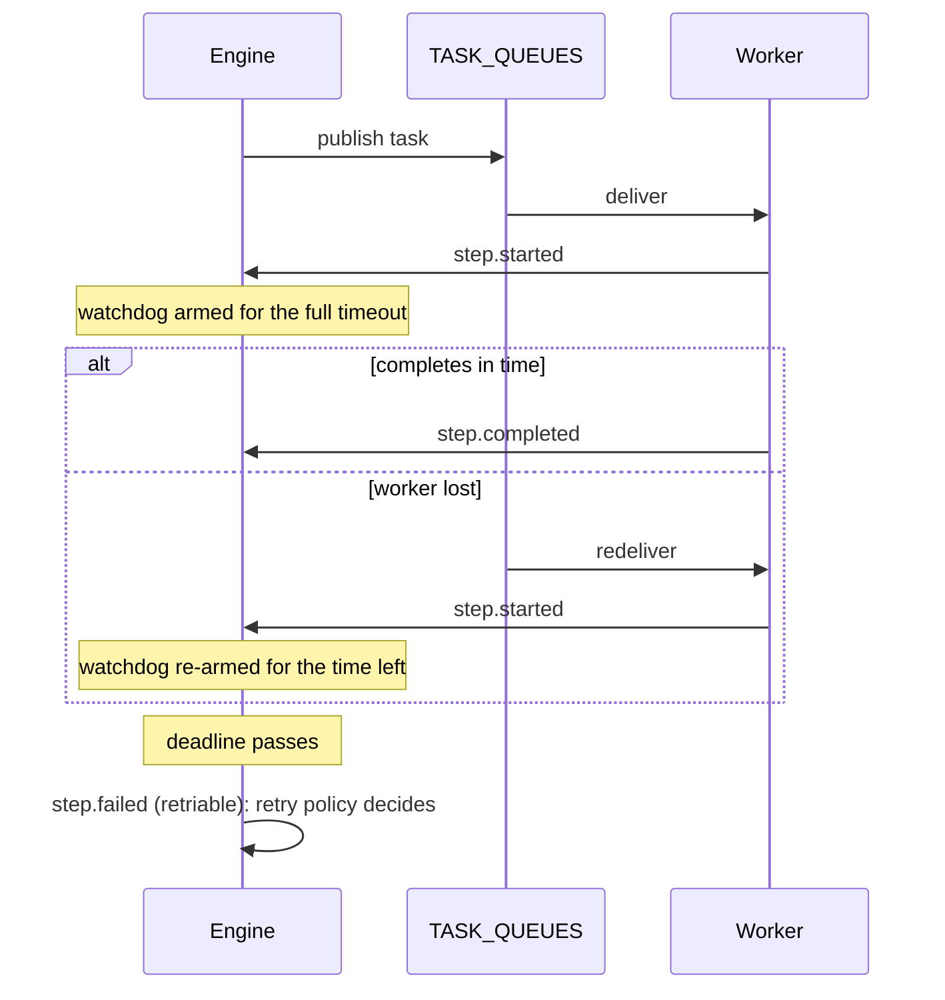

Give every step a timeout. A step without one (`timeout` unset or `0`) gets no watchdog and can run as long as its workers keep it alive.

## Per-Step Timeout

The `Timeout` field on `StepDef` sets the maximum wall-clock time an attempt has to complete before the engine considers it failed.

```go
wf := dag.NewWorkflow("data-pipeline")

fetch := wf.Task("fetch", "http-fetch").
    WithTimeout(30 * time.Second)

transform := wf.Task("transform", "process").
    After(fetch).
    WithTimeout(5 * time.Minute)
```

The engine enforces the timeout itself. When an attempt starts, it arms a durable watchdog timer for that attempt. If the step is still running on the same attempt when the timer fires, the engine fails the attempt with a retriable `step timeout exceeded` error, which then goes through the step's [retry policy](/docs/reliability/retry-policies) like any other failure.

### Redelivery does not restart the clock

A worker that dies, or stops extending its claim, loses the task, and NATS redelivers it to another worker. A redelivery does not restart the timeout: the clock keeps running from when the step's current attempt first started, so a step whose workers keep losing it fails at its timeout instead of running forever. Time spent in `Pause()` counts too: a resumed task continues the same clock, so a step that pauses repeatedly needs a timeout that covers its whole run. Only a retry the engine schedules starts with a fresh timeout.



Workers hold their claim on a task by heartbeating. `Heartbeat()` sends an `InProgress()` signal to NATS so the message is not redelivered while the handler is still working. It does not extend the step timeout:

```go
w.Handle("long-task", func(ctx worker.TaskContext) error {
    for i := 0; i < 100; i++ {
        processChunk(i)
        ctx.Heartbeat() // keep the claim; the step timeout still applies
    }
    return ctx.Complete([]byte(`{"chunks":100}`))
})
```

## Per-Workflow Timeout

The optional `Timeout` field on `WorkflowDef` sets an overall deadline for the entire run. When set, the engine computes a `Deadline` on the `WorkflowRun` at creation time.

```go
wf := dag.NewWorkflow("bounded-pipeline").
    WithTimeout(30 * time.Minute)
```

The deadline is checked when the engine handles the next event for the run, not by a timer of its own. If a run is still `running` past its deadline at that point, the engine cancels all in-flight steps and marks the run `cancelled`, not `failed`. Non-detached child workflows are cancelled with it. A run that produces no further events is not cancelled until one arrives, so set step timeouts too. The workflow timeout acts as a safety net: individual step timeouts handle the common case, and the workflow timeout catches pathological scenarios like cascading retries.

## Timeout Guidance

| Scenario | Recommended Timeout |
|----------|-------------------|
| HTTP API call | 10-60s |
| LLM inference | 60-300s |
| File processing | 1-10m |
| Agent loop (total) | 10-30m |
| End-to-end pipeline | 30-120m |

Set step timeouts based on the **worst-case expected duration** plus headroom for retries. The workflow timeout should exceed the sum of the critical path's step timeouts.

## Validation

The validator does not require a step `Timeout`, so a missing one is not an error: that step simply has no watchdog. Set one on every step anyway, since unbounded execution is a reliability hazard in production. The validator does require a workflow `Timeout` for hard-sticky workflows, and a positive timeout on approval and wait-for-event steps.

## Related Pages

- [Retry Policies](/docs/reliability/retry-policies) -- what happens after a timeout
- [Error Handling](/docs/reliability/error-handling) -- failure semantics
- [Cancellation](/docs/reliability/cancellation) -- manual termination
