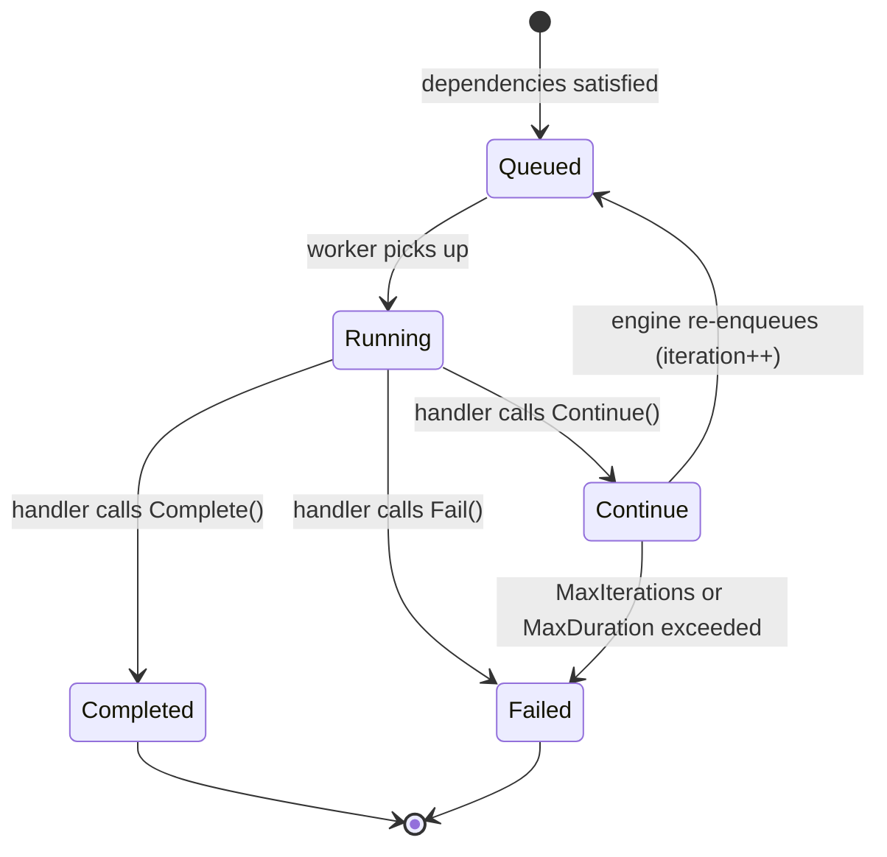

An **agent loop** step iterates until the handler signals completion or a bound is reached, making it the native primitive for LLM agent reasoning cycles.

## Overview

Agent loops solve a fundamental problem in AI workflows: the number of iterations is not known at definition time. An LLM agent might need 3 tool-call rounds or 30, depending on the task. Rather than modeling this as a fixed chain of steps, `StepTypeAgentLoop` lets a single step iterate in place, calling `Continue()` to request another iteration or `Complete()` to terminate.

Each iteration is a full task dispatch cycle -- the engine re-enqueues the step with an incremented iteration counter, and the worker picks it up again. This means every iteration gets its own NATS message with dedup protection, its own timeout enforcement, and its own trace span. The conversation state persists across iterations through the `Checkpoint()` / `LoadCheckpoint()` API on the worker's `TaskContext`: `Checkpoint()` buffers the state, and `Continue()` sends it inside the `step.continue` event, so the engine saves the state and advances the iteration in one write.

A crash inside an iteration repeats that iteration. To recover at the level of a single model call or tool call instead, have the handler call `Journal()`. See [Durable Agents](/docs/ai-patterns/durable-agents).

Two hard bounds prevent runaway loops: **MaxIterations** caps the number of cycles, and **MaxDuration** caps wall-clock time. `Build()` and `workflow validate` reject an agent loop without `max_iterations`. Whichever fires first terminates the loop. An optional **LoopDelay** adds spacing between iterations for rate-limited APIs.

## How It Works



When the engine enqueues an agent loop step, it includes the current `Iteration` count in the `TaskPayload`. The worker handler loads any saved checkpoint (conversation history, tool results), performs one reasoning cycle, and decides:

- **`Continue(output)`** -- publish a `step.continue` event. The engine increments the iteration counter, checks bounds, and re-enqueues the task. The next iteration gets the same input as the first one (the step's upstream outputs, or the run input), not the output of `Continue()`. Carry state between iterations with `Checkpoint()` and `LoadCheckpoint()`. The `Continue()` output is kept only in the `step.continue` event in the run's history.
- **`Complete(output)`** -- publish a `step.completed` event. The loop terminates successfully, and downstream steps receive the final output.
- **`Fail(err)`** -- publish a `step.failed` event. Retry policy applies as normal.

Lifecycle events carry the identity of the dispatch they answer: `iteration`, `attempt` and `dispatch_nonce`. The engine applies `step.continue`, `step.completed` and `step.failed` only while the step is still on that dispatch, and drops anything else. A duplicate `Continue()` for one iteration advances the loop once, and a stalled worker that wakes up after another worker took over cannot complete the step. Message IDs are `{run}.{step}.{type}.{attempt}.{iteration}`, so a redelivery inside the dedup window is caught by JetStream and one outside it by the engine. Events from workers built before this fence are accepted while the engine setting `legacy_step_events` is on (the default); see [Configuration](/docs/operations/configuration).

A crash between `Checkpoint()` and `Continue()` leaves nothing behind. The redelivered iteration starts from the state the crashed one started from.

### Waiting between iterations

`Continue()` takes options that make the engine wait before it sends the next iteration:

```go
return ctx.Continue(out, worker.Delay(10*time.Minute))
return ctx.Continue(out, worker.Until(deadline))
return ctx.Continue(out, worker.UntilInput(), worker.Delay(time.Hour))
```

`UntilInput()` wakes the step when someone submits an input for it with `POST /runs/{id}/steps/{step}/inputs`. Options combine and wake on whichever comes first. The wait is saved on the step, with no worker holding a claim, and survives an engine restart. The step's `timeout` and the loop's `max_duration` keep counting during the wait. See [Durable Agents](/docs/ai-patterns/durable-agents#durable-waits).

### Cancellation

`ctx.Context()` is cancelled when the run is cancelled. Pass it to model and tool calls and return when it ends. See [Cancellation](/docs/reliability/cancellation).

## Usage

```go
wf := dag.NewWorkflow("code-review")

review := wf.AgentLoop("review", "llm-review").
    WithMaxIterations(10).
    WithMaxDuration(5 * time.Minute).
    WithLoopDelay(500 * time.Millisecond).
    WithTimeout(30 * time.Second)

def, err := wf.Build()
```

The handler uses checkpoint to persist conversation state:

```go
w.Handle("llm-review", func(ctx worker.TaskContext) error {
    history, _ := ctx.LoadCheckpoint()
    if history == nil {
        history = ctx.Input()
    }
    result, err := callLLM(ctx.Context(), history)
    if err != nil {
        return ctx.Fail(err)
    }
    if err := ctx.Checkpoint(result.FullHistory); err != nil {
        return err
    }
    if result.Done {
        return ctx.Complete(result.Summary)
    }
    return ctx.Continue(result.ToolOutput)
})
```

## Configuration

Agent loop configuration is stored in `StepDef.Config` as `AgentLoopConfig`:

| Field | Type | Default | Purpose |
|-------|------|---------|---------|
| `max_iterations` | `int` | (required) | Maximum number of loop cycles. Must be > 0. |
| `max_duration` | duration | 0 (unlimited) | Wall-clock bound, measured from the first `Continue()`. Checked each time the handler calls `Continue()`. |
| `loop_delay` | duration | 0 (none) | Delay between re-enqueue cycles. Scheduled as a durable timer, so an engine restart does not lose it. Does not apply to an iteration that waits |
| `budget_warn_at` | `int` | 0 (off) | Advisory. The engine does not enforce it; workers read it to warn the model that iterations are running out. |
| `budget_force_at` | `int` | 0 (off) | Advisory, like `budget_warn_at`. Workers read it to force a final answer. |

In workflow JSON, durations accept strings such as `"5m"` or integer nanoseconds. A loop that reaches `max_iterations` fails when the handler calls `Continue()` for the `max_iterations`-th time, so a handler runs at most `max_iterations` times.

The state a handler checkpoints is capped per step by the engine setting `loop_state_max_bytes` (256 KiB by default); `Continue()` fails over the cap. A step that uses `Journal()` is not subject to the cap.

The `StepDef.Timeout` field controls the per-iteration timeout, not the total loop duration. Set `max_duration` to bound total wall-clock time.

## Related

- [Durable Agents](/docs/ai-patterns/durable-agents) -- journal, tool replay, inputs, waits and cancellation
- [Normal Steps](/docs/step-types/normal-steps) -- single-execution counterpart
- [Steps](/docs/concepts/steps) -- step lifecycle and StepDef fields
