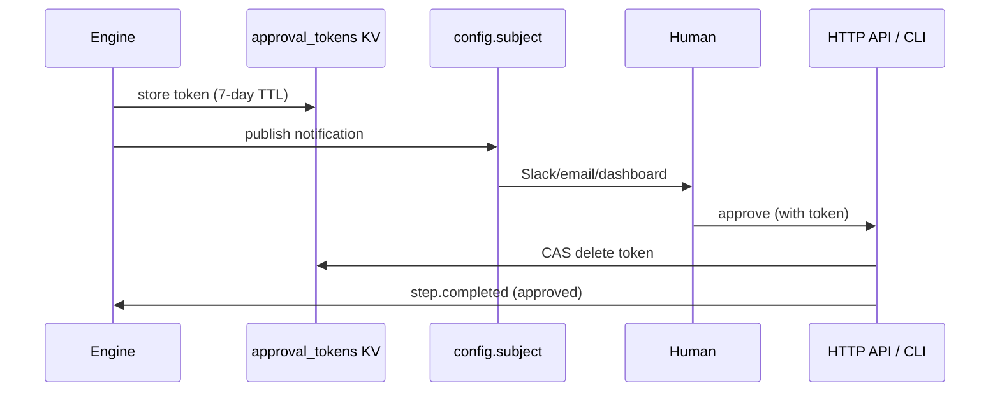

An **approval gate** pauses workflow execution until a human explicitly approves or rejects it, enabling human-in-the-loop workflows for sensitive operations.

## Overview

Approval gates address the requirement that some workflow steps should not proceed without human review. A deploy to production, a financial transaction above a threshold, or an AI agent's proposed action -- these are cases where automation must yield to human judgment.

When the engine reaches a `StepTypeApproval` step, it generates a **256-bit cryptographically random token**, stores it in the `approval_tokens` KV bucket with a 7-day TTL, and publishes a notification to the NATS subject set in the step's `subject` config. The notification carries the token, run ID, step ID, description, metadata and expiry time. External integrations (Slack bots, email systems, dashboards) subscribe to this subject and present the approve/reject action to the appropriate human. No worker is involved in the step itself.

The token ensures that only someone who received the notification can act on the approval. Atomic consumption via CAS (compare-and-swap) on the KV entry prevents double-approve race conditions. Once consumed, the token cannot be reused.

## How It Works



When a human approves or rejects:

- **Approve**: the step completes. Its output is the request body you sent with the approval (empty if none), so downstream steps can read a comment or approver name from it. Downstream steps proceed normally.
- **Reject**: the step fails with the request body as its error text (`approval rejected` if there is no body), and the run fails.
- **Timeout**: if no action is taken within the configured timeout (max 7 days), the step fails and the run fails.

The API exposes one endpoint for approval actions, with `action` set to `approve` or `reject`. Both `action` and `token` are required. An optional JSON body (for example `{"comment": "...", "approved_by": "..."}`, up to 1 MiB) becomes the step output on approve, or the error text on reject:

```
POST /runs/{id}/approval/{step_id}?action=approve&token={token}
POST /runs/{id}/approval/{step_id}?action=reject&token={token}
```

A wrong or expired token answers 401, a token already used answers 409, and a missing token or bad `action` answers 400. There is no CLI command for approvals; call the endpoint.

## Usage

```go
wf := dag.NewWorkflow("production-deploy")

plan := wf.Task("plan", "terraform-plan").
    WithTimeout(5 * time.Minute)

approve := wf.Approval("approve-deploy", dag.ApprovalConfig{
    Timeout:     24 * time.Hour,
    Subject:     "approval.deploy.production",
    Description: "Review terraform plan before apply",
    Metadata: map[string]string{
        "team":        "platform",
        "environment": "production",
    },
}).After(plan)

apply := wf.Task("apply", "terraform-apply").
    After(approve).
    WithTimeout(10 * time.Minute)

def, err := wf.Build()
```

## Configuration

Approval configuration is stored in `StepDef.Config` as `ApprovalConfig`:

| Field | Type | Required | Purpose |
|-------|------|----------|---------|
| `timeout` | duration | Yes | How long to wait for a decision. Max 168h (7 days). |
| `subject` | `string` | Yes | NATS subject for notification publication |
| `description` | `string` | No | Human-readable description of what is being approved |
| `metadata` | `map[string]string` | No | Arbitrary key-value pairs passed in the notification |

**Constraints:**

- Timeout must be positive and at most 168 hours (7 days)
- Subject must be non-empty
- Token is 256-bit, cryptographically random
- Token stored in the `approval_tokens` KV bucket, which has a 7-day TTL
- Workflow JSON accepts durations as strings, for example `"timeout": "24h"`
- CAS prevents double-approve

## Related

- [Wait for Event](/docs/step-types/wait-for-event) -- programmatic event correlation
- [Normal Steps](/docs/step-types/normal-steps) -- standard automated execution
