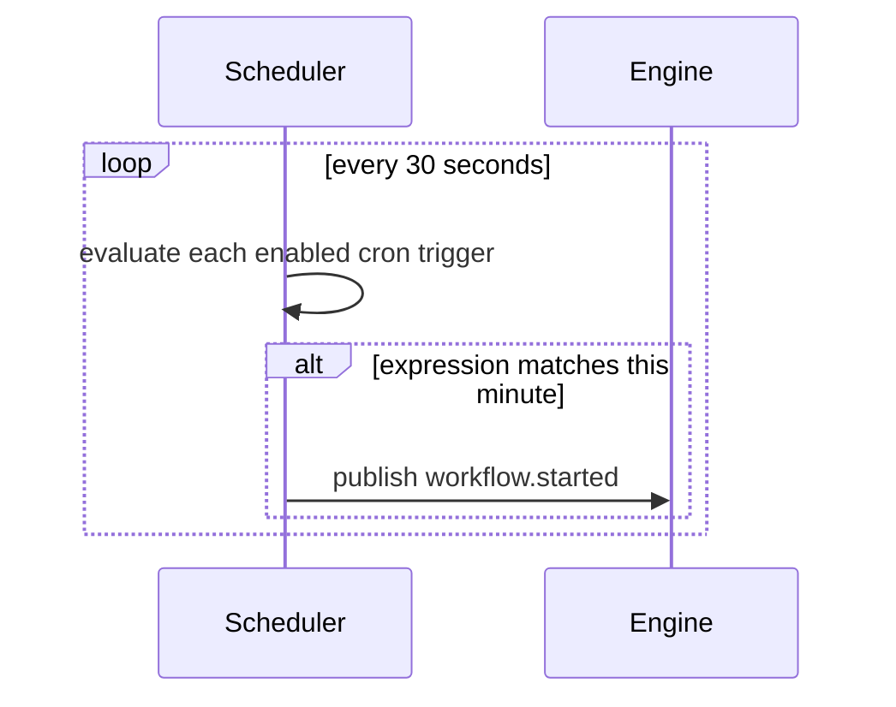

Cron triggers start workflow runs on a recurring schedule. They are managed with `dagnats trigger` and stored in the `triggers` KV bucket.

## Creating a Cron Trigger

Pass the workflow name, then `--cron`. Flags go after the workflow name:

```bash
dagnats trigger create report-pipeline --cron "0 9 * * *"
```

This creates a trigger that starts a `report-pipeline` run every day at 09:00 UTC. The CLI prints the new trigger's ID (`trig-` plus 16 hex characters); there is no flag to choose it. A trigger has exactly one type, so `--cron`, `--subject` and `--webhook` are mutually exclusive.

The run's input is a trigger envelope. A cron trigger has no input of its own:

```json
{
  "trigger": "cron",
  "source": "trig-0123456789abcdef",
  "workflow_id": "report-pipeline",
  "timestamp": "2026-10-19T09:00:00Z"
}
```

`source` is the trigger ID, and `timestamp` is the moment the trigger fired, in UTC.

## Cron Syntax

DagNats uses five-field cron syntax. A six-field expression with seconds is an error, and so is an expression longer than 256 bytes.

```
┌───────────── minute (0-59)
│ ┌───────────── hour (0-23)
│ │ ┌───────────── day of month (1-31)
│ │ │ ┌───────────── month (1-12)
│ │ │ │ ┌───────────── day of week (0-6, Sunday=0)
│ │ │ │ │
* * * * *
```

Each field takes `*`, `*/N`, a range `N-M`, a number, or a comma list of those. Names such as `MON` and `JAN` are not supported, and Sunday is `0` only, not `7`.

When both day-of-month and day-of-week are restricted (neither is a bare `*`), a day matches if **either** field matches, as in Vixie cron. `0 9 1 * 1` fires on the 1st of the month and on every Monday.

| Expression | Schedule |
|------------|----------|
| `*/15 * * * *` | Every 15 minutes |
| `0 9 * * 1-5` | Weekdays at 9:00 AM |
| `0 0 1 * *` | First of every month at midnight |
| `30 */2 * * *` | Every 2 hours at :30 |

Check an expression and see its next fire times before you create the trigger. Put the flags before the expression:

```bash
dagnats trigger test --tz America/Denver --count 3 "0 9 * * 1-5"
```

## Timezone

By default, cron expressions are evaluated in UTC. Set an IANA zone with `--tz`:

```bash
dagnats trigger create notify --cron "0 9 * * 1-5" --tz "America/Denver"
```

The server does not check the zone when it creates the trigger. A bad name makes the trigger fail every time it is evaluated, so run `dagnats trigger test --tz ZONE` first. Zone data is built into the binary, so named zones work in minimal images that ship no zoneinfo.

This `--tz` applies to cron triggers. A [cron sleep step](/docs/step-types/sleep-and-timers) uses `cron_timezone` instead, and it also defaults to UTC.

## Managing Triggers

```bash
# List all triggers
dagnats trigger list

# Change a trigger
dagnats trigger update trig-0123456789abcdef --cron "0 10 * * *" --tz UTC

# Pause and resume
dagnats trigger disable trig-0123456789abcdef
dagnats trigger enable trig-0123456789abcdef

# Fire it now, outside its schedule
dagnats trigger fire trig-0123456789abcdef

# Recent fires
dagnats trigger history trig-0123456789abcdef --limit 5

# Delete a trigger
dagnats trigger delete trig-0123456789abcdef
```

`trigger fire` starts a run immediately with `"trigger": "manual"` in the envelope. Every fire, scheduled or manual, is recorded in the `TRIGGER_HISTORY` stream, which `trigger history` reads. A trigger created from a `dagnats.yaml` file is file-managed. `trigger delete` refuses to remove it unless you pass `--force`, because the file watcher would recreate it.

## How It Works



The scheduler runs inside the `dagnats serve` process and ticks every 30 seconds. Cron has one-minute resolution, so the scheduler remembers the last minute it fired for each trigger and ignores the second tick in the same minute. The `workflow.started` publish also carries a message ID built from the trigger and the minute, so a duplicate is dropped by JetStream. Each trigger is evaluated independently, so one failing trigger does not block the others.

### Missed fires

Each cron fire records its minute as `<trigger-id>.last_run_at` in the `trigger_state` KV bucket. By default, a minute missed while the server is down is skipped.

A trigger with `--backfill` (or `backfill: true` in a `dagnats.yaml` trigger) catches up when the trigger service starts: it fires once for every matching minute between `last_run_at` and now, oldest first, up to 100 fires per trigger. A trigger that has never fired has no `last_run_at`, so it has nothing to replay. Replay runs only at startup; a trigger registered or updated on a running server is not backfilled. In a cluster the mark is shared, so a node that restarts does not replay minutes the other nodes already fired.

## Related Pages

- [CLI and API](/docs/triggers/cli-and-api) -- manual run triggers
- [Event Triggers](/docs/triggers/event-triggers) -- event-driven triggers
- [Concurrency Limits](/docs/flow-control/concurrency-limits) -- preventing trigger overload
