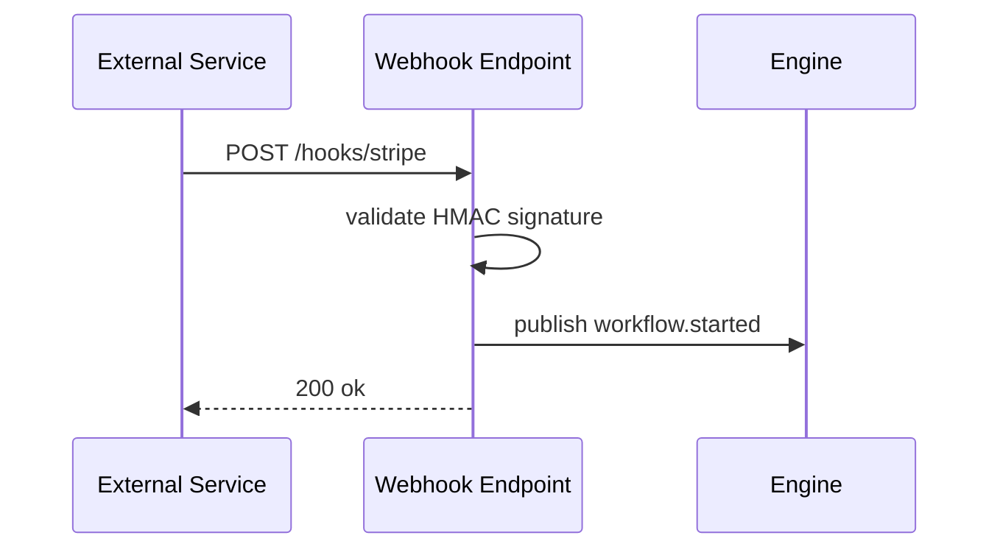

Webhook triggers expose an HTTP endpoint that starts a workflow run for each incoming request, bridging external services like GitHub, Stripe, or custom systems into DagNats workflows. The caller gets an acknowledgement and never sees the workflow's output; for a synchronous response use the [HTTP trigger](/docs/triggers/http).

## How It Works

The webhook endpoint runs on the `dagnats serve` HTTP listener. The server hands every request under `/hooks/` to the webhook table, which looks up the trigger by the exact request path.



The endpoint publishes `workflow.started` directly. It does not publish anything to the `EVENTS` stream, so an event trigger cannot listen to a webhook.

## Creating a Webhook Trigger

Pass the workflow name, then `--webhook` with the request path:

```bash
dagnats trigger create payment-processor \
  --webhook /hooks/stripe-payment \
  --secret "whsec_stripe_secret"
```

The path must start with `/`. Only paths under `/hooks/` reach the webhook table, so use `/hooks/NAME`. The server answers requests to this URL, for example `http://localhost:8080/hooks/stripe-payment`, and nothing else is needed on the CLI side. The CLI prints the new trigger's ID.

The run's input is a trigger envelope, and the request body is its `data` field:

```json
{
  "trigger": "webhook",
  "source": "trig-0123456789abcdef",
  "workflow_id": "payment-processor",
  "timestamp": "2026-10-19T09:00:00Z",
  "data": { "...": "the request body" }
}
```

The body must be valid JSON. Webhook requests do not check `Content-Type`.

## Request Validation

When the trigger has a secret, the endpoint validates an HMAC-SHA256 signature. Without a secret, it accepts every request.

### Setting the Secret

`--secret` stores the secret on the trigger. If you omit it, the CLI falls back to the `DAGNATS_WEBHOOK_SECRET` environment variable of the shell running `trigger create`, which keeps the secret out of your shell history. The server itself never reads that variable; the value is copied into the trigger when it is created.

```bash
export DAGNATS_WEBHOOK_SECRET="whsec_your_secret_here"
dagnats trigger create ci-pipeline --webhook /hooks/github-push
```

### Signature Verification

The sender computes `HMAC-SHA256(secret, request_body)`, hex-encodes it, and sends it as `X-Signature-256: sha256=<hex>`. A missing header, a missing `sha256=` prefix, or a wrong digest answers `401 invalid signature`.

## Responses

| Status | Meaning |
|--------|---------|
| `200` | Accepted. The body is `ok`. If the trigger is disabled, the request is acknowledged and no run starts. |
| `401` | Bad or missing signature |
| `405` | Method is not `POST` |
| `413` | Body larger than 1 MiB |
| `500` | The run could not be published |

## Related Pages

- [Event Triggers](/docs/triggers/event-triggers) -- NATS subject triggers
- [HTTP Trigger](/docs/triggers/http) -- webhook-style endpoints that return the workflow's output
- [CLI and API](/docs/triggers/cli-and-api) -- manual run creation
